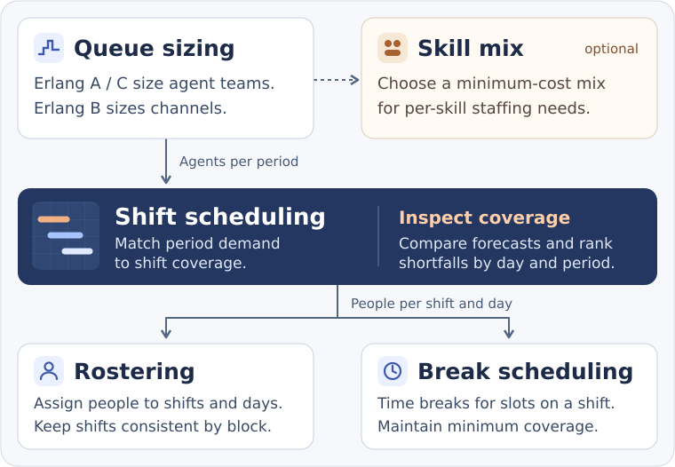

# PyWorkforce

[](https://pypi.org/project/pyworkforce/)
[](https://pypi.org/project/pyworkforce/)
[](https://github.com/rodrigo-arenas/pyworkforce/actions/workflows/ci-tests.yml)
[](https://codecov.io/github/rodrigo-arenas/pyworkforce?branch=main)

**Workforce planning in Python, from queue staffing to shift schedules.**
How many people do you need, and when? PyWorkforce uses Erlang models to size queues
and OR-Tools to turn staffing requirements into shifts, rosters, and break schedules.
Bring your own demand forecast and inspect the results in pandas.

[Quick start](https://pyworkforce.rodrigo-arenas.com/stable/guide/quickstart) ·
[Worked planning tutorial](https://pyworkforce.rodrigo-arenas.com/stable/guide/end-to-end) ·
[Runnable examples](https://github.com/rodrigo-arenas/pyworkforce/tree/main/examples)

## Installation

Use Python 3.12–3.14 and install the package from PyPI.

```bash
python -m pip install pyworkforce
```

## Build your first shift schedule

A service desk needs **2 people in the morning, 3 at midday, and 1 in the afternoon**.
Early and Late shifts overlap at midday. How many people should start each shift?

```python
from pyworkforce.scheduling import MinRequiredResources

plan = MinRequiredResources(
    num_days=1,
    periods=3,
    required_resources=[[2, 3, 1]],  # people needed in each period
    shifts_coverage={"Early": [1, 1, 0], "Late": [0, 1, 1]},
    max_shift_concurrency=3,
    max_period_concurrency=3,
)
solution = plan.solve()
print(solution["status"], plan.scheduled_resources())
```

```text
OPTIMAL {'Early': [2], 'Late': [1]}
```

Schedule **two people on Early and one on Late**. The overlap covers all three
midday positions. If afternoon demand rises to two, evaluate the same assignments
against the new forecast.

```python
coverage = plan.coverage([[2, 3, 2]])
print(coverage[["period", "required", "scheduled", "shortfall"]].to_string(index=False))
```

```text
 period  required  scheduled  shortfall
      0         2          2          0
      1         3          3          0
      2         2          1          1
```

The afternoon is one person short. For charts, install `python -m pip install "pyworkforce[plot]"`.
The [coverage tutorial](https://pyworkforce.rodrigo-arenas.com/stable/guide/coverage-scenarios)
shows how to plot the gap. The [shift coverage guide](https://pyworkforce.rodrigo-arenas.com/stable/guide/shifts)
shows how to describe longer shifts using clock hours.

## Planning pipeline



Start at the decision you need to make. After solving a shift schedule, pass
`scheduled_resources()` to the roster as `required_resources`, or to the break
scheduler as `scheduled_resources`, along with each tool's constraints.

| Your question | Model or API | Worked guide |
| --- | --- | --- |
| How many agents will meet our answer-time target? | `ErlangC` for waiting callers, `ErlangA` when callers may abandon | [Waiting](https://pyworkforce.rodrigo-arenas.com/stable/guide/erlangc) · [Abandonment](https://pyworkforce.rodrigo-arenas.com/stable/guide/erlanga) |
| How many channels will keep blocking below target? | `ErlangB` for traffic lost when all channels are busy | [Channel sizing](https://pyworkforce.rodrigo-arenas.com/stable/guide/erlangb) |
| Which combination of skills covers demand at minimum cost? | `MultiSkillStaffing` | [Skill profiles](https://pyworkforce.rodrigo-arenas.com/stable/guide/staffing) |
| How many people should work each shift? | `MinRequiredResources` for full coverage, `MinAbsDifference` to minimize coverage error | [Shift scheduling](https://pyworkforce.rodrigo-arenas.com/stable/guide/scheduling) |
| Where will the schedule fall short if demand changes? | `coverage()` and `compare_coverage()` on the solved plan | [Demand scenarios](https://pyworkforce.rodrigo-arenas.com/stable/guide/coverage-scenarios) |
| Who works which days and shifts? | `MinHoursRoster` with availability rules and preferences | [Named rosters](https://pyworkforce.rodrigo-arenas.com/stable/guide/rostering) |
| When can people take breaks and still meet minimum coverage? | `BreakScheduler` places breaks for anonymous slots on each shift | [Break placement](https://pyworkforce.rodrigo-arenas.com/stable/guide/breaks) |

On the `main` branch, you can also compare shortfalls by day and period across forecasts
with `compare_coverage(..., by_period=True)` and `plot_period_shortfalls()`, or keep
each person's shift consistent with `shift_block_starts`. See the
[scenario example](https://github.com/rodrigo-arenas/pyworkforce/blob/main/examples/scheduling/prioritize_shortfalls.py)
and the [roster example](https://github.com/rodrigo-arenas/pyworkforce/blob/main/examples/rostering/shift_blocks.py).

## Start from call volume

Erlang C turns forecast call volume into a staffing requirement. For **100 calls in 30 minutes**, assume a three-minute average handle
time, an 80% answer target within 20 seconds, and 30% shrinkage.

```python
from pyworkforce.queuing import ErlangC

queue = ErlangC(transactions=100, aht=3, asa=20 / 60, interval=30, shrinkage=0.30)
staff = queue.required_positions(service_level=0.80, max_occupancy=0.85)
print(f"{staff['raw_positions']} productive agents, {staff['positions']} to schedule")
```

```text
14 productive agents, 20 to schedule
```

Explore how headcount affects [service level and occupancy](https://pyworkforce.rodrigo-arenas.com/stable/guide/staffing-curve),
or [run several Erlang scenarios](https://pyworkforce.rodrigo-arenas.com/stable/guide/multierlang) in one batch.

## Project and community

PyWorkforce is a beta-stage, MIT-licensed project. The
[stable documentation](https://pyworkforce.rodrigo-arenas.com/stable/) and
[release notes](https://pyworkforce.rodrigo-arenas.com/stable/release-notes) cover the published package.
For a bug report or a planning use case, [open an issue](https://github.com/rodrigo-arenas/pyworkforce/issues).
To contribute a model, fix, or example, see the
[contributing guide](https://github.com/rodrigo-arenas/pyworkforce/blob/main/CONTRIBUTING.md)
and [license](https://github.com/rodrigo-arenas/pyworkforce/blob/main/LICENSE).
