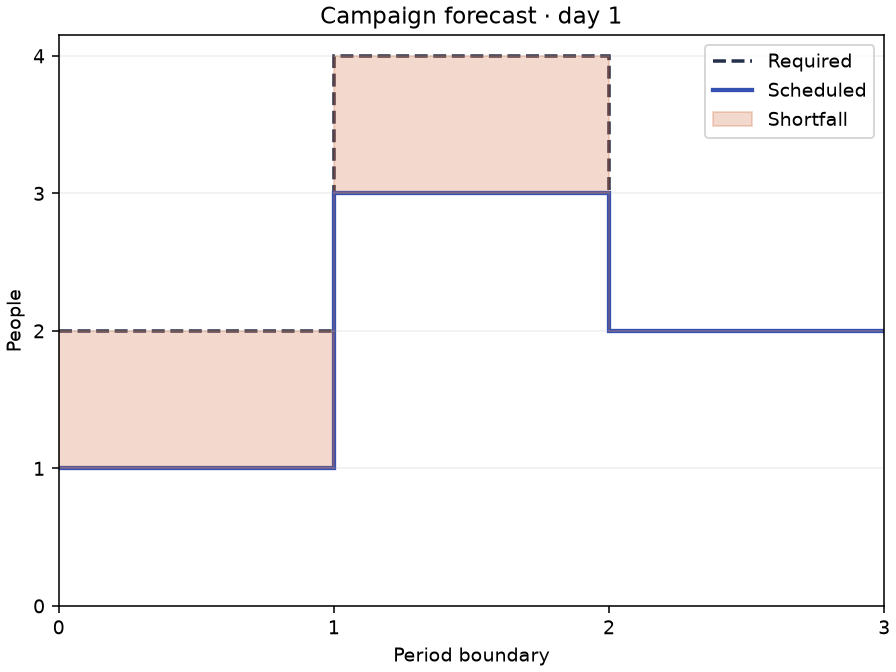
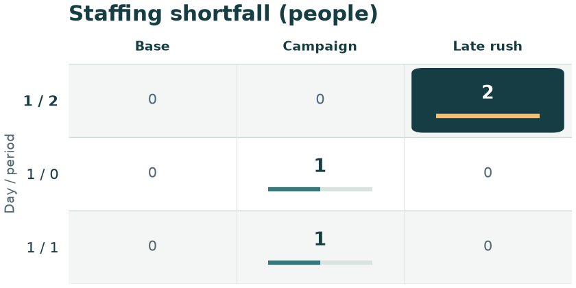

# Stress-test a shift schedule against demand

A schedule can meet the forecast and still leave a gap if demand rises. In this
tutorial, solve one two-day schedule and evaluate the same assignments against
a busier forecast. Install `pyworkforce` 0.6.0 or later with the
[plotting extra](/guide/installation#plotting) to run the full example.

## Set staffing limits and solve once

The two shifts overlap in period 1. On day 0, require at least two people on the
early shift and allow at most one on the late shift. On day 1, lock the two
headcounts to reflect an existing commitment. Keys are `(day, shift_name)` and
bounds are inclusive. A `(0, 0)` limit closes that shift for the day.

```python
from pyworkforce.plotting import plot_coverage
from pyworkforce.scheduling import MinRequiredResources

base = [[2, 3, 1], [1, 2, 2]]
campaign = [[2, 3, 1], [2, 4, 2]]
scheduler = MinRequiredResources(
    num_days=2,
    periods=3,
    shifts_coverage={"early": [1, 1, 0], "late": [0, 1, 1]},
    required_resources=base,
    max_period_concurrency=3,
    max_shift_concurrency=3,
    shift_limits={
        (0, "early"): (2, 3),
        (0, "late"): (0, 1),
        (1, "early"): (1, 1),
        (1, "late"): (2, 2),
    },
    num_search_workers=1,
)

solution = scheduler.solve()
if solution["status"] not in {"OPTIMAL", "FEASIBLE"}:
    raise RuntimeError(solution["status"])

print(scheduler.scheduled_resources())
comparison = scheduler.compare_coverage({"base": None, "campaign": campaign})
print(comparison.to_string(index=False))

ax = plot_coverage(scheduler.coverage(campaign), day=1)
ax.set_title("Campaign forecast · day 1")
ax.figure.savefig("campaign-coverage.png", dpi=140)
```

## Read the gaps before making changes

The base forecast is fully covered, with one surplus person-period. The
campaign leaves two person-periods uncovered, one in each of the first two
periods of day 1. A person-period counts one person for one interval. An agent
working three intervals contributes three person-periods.



`compare_coverage()` evaluates the existing plan. To optimize for the campaign,
solve a new scheduler with the campaign as `required_resources`. In this
example, covering four people in period 1 requires raising the overall period
cap and revisiting the locked shift counts. Use `MinAbsDifference` when a plan
with explicit remaining shortfalls is acceptable.

To plan breaks separately, pass `scheduler.scheduled_resources()` to
[`BreakScheduler`](/guide/breaks) as `scheduled_resources`. Check coverage
against your chosen forecast before scheduling breaks.

## Which interval needs extra people first?

In the development version, compare the campaign with a late rush using the
schedule solved above. Both forecasts leave two person-periods uncovered.

```python
from pyworkforce.plotting import plot_period_shortfalls

late_rush = [[2, 3, 1], [1, 2, 4]]
scenarios = {"Base": None, "Campaign": campaign, "Late rush": late_rush}
shortfalls = scheduler.compare_coverage(scenarios, by_period=True)
print(shortfalls.head(3).to_string())
ax = plot_period_shortfalls(shortfalls, limit=3)
```

```text
scenario    Base  Campaign  Late rush
day period
1   2          0         0          2
    0          0         1          0
    1          0         1          0
```

If the late rush materializes, move two people into the last interval of day 1.
For the campaign, cover the first two intervals of that day with one extra
person each. The base forecast needs no additional staff in any interval.
The full table also includes the three fully covered intervals on day 0.



To reproduce the figure, run `python examples/scheduling/prioritize_shortfalls.py`
from a development checkout installed with `pip install -e ".[plot]"`.
