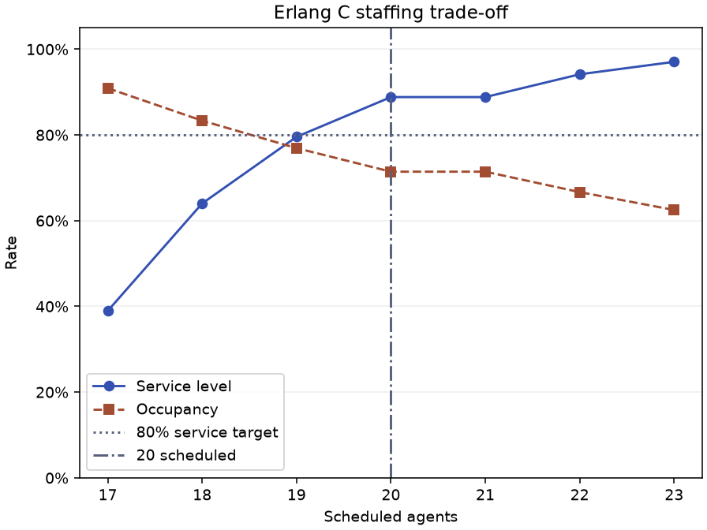

# Choose staffing with an Erlang C curve

A service target tells you the minimum viable headcount. A staffing curve also
shows what one more scheduled agent would change. For a forecast of 100 calls
per half hour and a three-minute handling time, find the smallest headcount
that meets 80% answered in 20 seconds with at most 85% occupancy.

## Compare candidate headcounts

Use `pyworkforce` 0.6.0 or later with the [plotting extra](/guide/installation#plotting).
The candidate counts include 30% shrinkage, so the model evaluates the
productive headcount after scaling. All times in the example are in minutes.

```python
from pyworkforce.plotting import plot_staffing_curve
from pyworkforce.queuing import ErlangC

model = ErlangC(transactions=100, aht=3, asa=20 / 60, interval=30, shrinkage=0.30)
curve = model.staffing_curve(range(17, 24), scale_positions=True)
eligible = curve[(curve["service_level"] >= 0.80) & (curve["occupancy"] <= 0.85)]
chosen = int(eligible["positions"].min())
print(f"Schedule {chosen} people")

ax = plot_staffing_curve(curve)
ax.axhline(0.80, color="#57617c", linestyle=":", label="80% service target")
ax.axvline(chosen, color="#57617c", linestyle="-.", label=f"{chosen} scheduled")
ax.set_xlabel("Scheduled agents")
ax.legend()
ax.figure.savefig("erlang-c-staffing-curve.png", dpi=140)
```

The smallest qualifying option is **20 scheduled agents**. It represents 14
productive agents and meets the service target at roughly 88.8% with 71.4%
occupancy. The table also reports the probability of waiting for each option.



Several scheduled counts can map to the same productive count. The flat
segments are a consequence of rounding down the available headcount. A
candidate whose productive headcount is at or below the traffic intensity
raises an error because the Erlang C queue would be unstable.

For callers who may leave while waiting, see [Erlang A](/guide/erlanga). For
screening many independent forecasts, see [scenario sweeps](/guide/scenarios).
