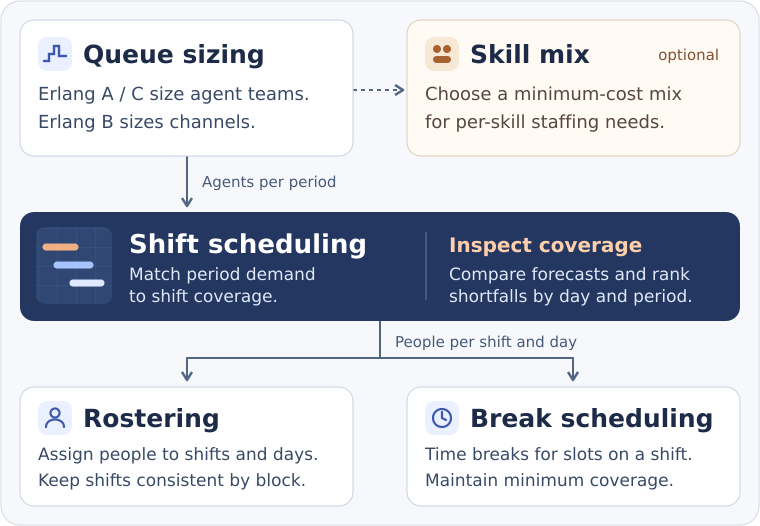

## Planning pipeline

pyworkforce is useful beyond contact centers: healthcare staffing, retail
operations, logistics, support teams, service desks and field operations all
share the same planning problem of matching variable demand to finite resources.

## Where should I start?

| Goal | Page |
| --- | --- |
| Install and run the first example | [Quick Start](/guide/quickstart) |
| Understand the full workflow | [End-to-end planning tutorial](/guide/end-to-end) |
| Size call-center agents for 80/20 | [Erlang C](/guide/erlangc) |
| Compare service and occupancy by headcount | [Erlang C staffing curve](/guide/staffing-curve) |
| Check a solved schedule against another forecast | [Schedule stress test](/guide/coverage-scenarios) |
| Model abandonment | [Erlang A](/guide/erlanga) |
| Size SIP trunks or channels | [Erlang B](/guide/erlangb) |
| Solve short practical tasks | [Recipes](/recipes/) |
| Check constructor and output details | [API Reference](/api/queuing) |
| Contribute examples, docs or solvers | [Contributing](/contributing) |
